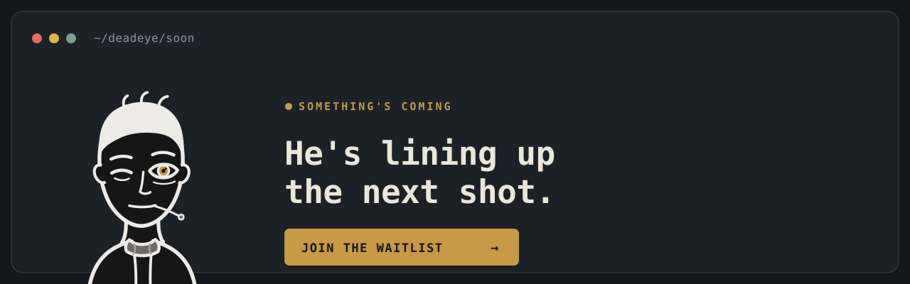

<p align="center">
  <picture>
    <source media="(prefers-color-scheme: dark)" srcset="assets/logo-dark.svg">
    
  </picture>
</p>

<h1 align="center">deadeye</h1>

<p align="center">
  <em>He doesn't waste shots.</em>
</p>

<p align="center">
  <a href="https://github.com/deepaksinghcs14/deadeye-cc/actions/workflows/ci.yml"></a>
  
  
  
  
  
  
</p>

He doesn't check twice, and he doesn't spray and pray. One round chambered,
one shot on target, and he's done — because the shot you never had to take
is the best one. deadeye puts that discipline inside your coding agent.

It watches what your agent is about to do — spawn a subagent, dump a noisy
test log, make a big multi-file edit — and fits the model, effort level, and
context to the task **before the tokens are spent, not after**. Everything it
remembers lives in one local folder, `~/.deadeye/`: no hosted service, no API
keys, no telemetry.

**[Full feature tour, with live examples → the site](https://deepaksinghcs14.github.io/deadeye-cc/)**

<p align="center">
  <a href="https://deepaksinghcs14.github.io/deadeye-cc/soon.html"></a>
</p>

## Install

| Host | Install | What you get |
|---|---|---|
| [Claude Code](#claude-code) | Plugin | The full engine, including model and effort routing |
| [Codex CLI](#codex-cli) | Plugin | Most of the engine; no model or effort routing |
| [Gemini CLI](#gemini-cli) | Extension | Coder persona and session guidance |
| [Cursor](#cursor) | `deadeye init cursor` | Persona, output trimming, exfiltration guard |
| [Windsurf](#windsurf) | `deadeye init windsurf` | Coder persona |

### Claude Code

```
/plugin marketplace add deepaksinghcs14/deadeye-cc
```
```
/plugin install deadeye@deadeye
```

Hooks and slash commands are live immediately. On macOS and Linux the binary
downloads itself on first use from
[Releases](https://github.com/deepaksinghcs14/deadeye-cc/releases),
sha256-verified.

<details>
<summary>Windows</summary>

Self-bootstrap isn't built for Windows yet. After the two commands above:

1. Download `deadeye_windows_amd64.exe` (or `_arm64`) from
   [Releases](https://github.com/deepaksinghcs14/deadeye-cc/releases).
2. Put it on `PATH` as `deadeye.exe`, or at
   `%USERPROFILE%\.deadeye\bin\deadeye.exe`.
3. Run `deadeye version` to confirm it resolves.
</details>

### Codex CLI

```
codex plugin marketplace add deepaksinghcs14/deadeye-cc
```
```
codex plugin add deadeye@deadeye
```

Then start Codex, run `/hooks`, and trust deadeye's hooks. Codex does not run
a plugin's hooks until you have reviewed them, and asks again when an update
changes them. The binary downloads itself on the first session (macOS/Linux).

You get output trimming, the exfiltration guard, the coder persona, the plan
gate, the codebase map and the decision log. **Not on Codex yet:** model and
effort routing.

<details>
<summary>Details, and installing without the plugin</summary>

The plugin's hooks are the ones `deadeye init codex` registers, addressed
from the plugin. That path installs and loads in Codex 0.162; it has not yet
been run end to end in a live session.

On a Codex too old for plugins, install the binary and run
`deadeye init codex`. It shows the exact changes to `$CODEX_HOME/hooks.json`
(or `~/.codex/hooks.json`), writes them only after you confirm, and installs
the `$deadeye-pr`, `$deadeye-review` and `$deadeye-vapt` user skills. Use one
path or the other — with both, every hook runs twice.
</details>

### Gemini CLI

Install the binary, then:

```
deadeye init gemini
```
```
gemini extensions install --path ~/.deadeye/gemini-extension
```

The first command writes a self-contained extension; the second is yours to
run, because deadeye never edits Gemini's own config. You get the coder
persona and session guidance (codebase map, vulnerable-dependency flag, soft
plan gate). Experimental: the tool-level features wait on a live check of
Gemini's tool schemas.

### Cursor

Install the binary, then, in the project you want it on:

```
deadeye init cursor
```

It writes the coder persona as a rules file and registers deadeye's hooks in
`~/.cursor/hooks.json`, after showing you both and asking. Hooks you already
have are kept. You get the persona, trimmed command output, the exfiltration
guard, session guidance and the decision log. Experimental: built from
[Cursor's hook documentation](https://cursor.com/docs/hooks) and not yet
confirmed in a live Cursor.

<details>
<summary>What runs through which hook, and what Cursor can't do</summary>

| You get | Through |
|---|---|
| Coder persona | The rules file, `.cursor/rules/deadeye.md` |
| Session guidance, codebase map, session memory | `sessionStart` |
| Trimmed command output | `preToolUse` on Shell |
| Exfiltration guard on commands and credential files | `preToolUse` and `beforeReadFile` |
| Advice on repeated commands and oversized MCP responses | `postToolUse` |

Not on Cursor: model routing (a hook can see a subagent's model but not
change it), the plan gate and per-turn advice (the prompt hook cannot inject
context), and the persona inside subagents. The guard blocks outright rather
than asking, because Cursor does not enforce "ask" on these hooks. If deadeye
itself fails, the hooks answer "allow"; it never blocks a tool call by
breaking.
</details>

### Windsurf

```
deadeye init windsurf
```

Writes the coder persona to `.windsurf/rules/deadeye.md`. Windsurf's hooks can
only block, with no way to rewrite a command or add context, so the persona
is all it gets.

### Review commands on every host

`deadeye init <host>` also installs `/deadeye-pr`, `/deadeye-review` and
`/deadeye-vapt` in that host's own command format. On Windsurf the rubrics
are shortened to fit its workflow size limit.

### Check it is working

```
deadeye doctor
```

One read-only pass over the plumbing: which binary is running, whether
`~/.deadeye` is private, whether `config.json` parses, the socket, the
daemon, whether the routing judge can reach `claude`, and whether the hooks
cover every tool deadeye handles. Each failure prints the command that fixes
it. Reach for it when deadeye seems to be doing nothing: `/deadeye-status`
shows what the settings are, and those can look perfect while the plumbing
underneath is broken.

### Uninstall

| Host | Command |
|---|---|
| Claude Code | `/plugin uninstall deadeye@deadeye` |
| Codex CLI | `codex plugin remove deadeye@deadeye` |
| Gemini CLI, Cursor, Windsurf, or a Codex `init` install | `deadeye uninstall <host>` |
| The binary and all local state | `deadeye uninstall --purge` |

From source: `go install github.com/deepaksinghcs14/deadeye-cc/cmd/deadeye@latest`

## Numbers

Every figure is measured on a real run. The rewrite happens *before* the
command runs, so only the part worth keeping ever enters context.

| Real run | Before | After | Cut |
|---|---:|---:|---:|
| `go test` with one genuine failure | 485 B | 99 B | **79.6%** |
| This repo's own suite (202 lines, all passing) | 10,301 B | 55 B | **99.5%** |
| `npm install express mocha` (progress spam) | 553 B | 55 B | **90.1%** |
| Coder persona a subagent inherits, per spawn | 9,499 B | 1,099 B | **88.4%** |

The command rows are logged to `~/.deadeye/decisions.jsonl`; the persona row
is measured off the two rendered rulesets. Run `/deadeye-stats savings` to
see your own.

## How it works

```
1. Look      Cheap, deterministic signals: files touched, recent git activity, nearby tests,
             how the request reads, whether it names something real, whether it's read-only
2. Decide    The cheapest (model, effort) that should still clear the bar for this task
3. Apply     Recommends the subagent's model and effort, or sets them if you turn on enforce;
             trims noisy command output; asks before a risky multi-file edit
4. Learn     Pick a bigger model than it recommended, and it gets more cautious
             for that kind of task next time
```

The rule behind all four: **when unsure, a capable middle — not the
priciest.** Thin evidence defaults to the sonnet tier; picking cheaper needs
real evidence above a confidence bar. When the signals can't place a task, a
routing judge classifies it with one small `claude -p` call on your own
login.

Every decision is printable: `/deadeye-route` shows the full reasoning.
deadeye advises by default and never touches your `settings.json`. If
anything inside it errors, your call passes through untouched.

## What it controls

Ten independent controls. Each has its own switch, and turning one off never
touches the others.

| What | Modes | What it does |
|---|---|---|
| Context hygiene | `off` / `on` | Trims verbose command output (tests across nine ecosystems, builds, linters, installs, log tails) before it enters context, and flags waste: re-reading unchanged files, re-running a command, an oversized MCP response. |
| Coder persona | `off` / `spotter` / `marksman` / `sniper` | A lean-first coding discipline, with a live security check on what's written, injected each session and into subagents. |
| Security | `off` / `advise` / `ask` | Exfiltration guard: reading a credential file, or a command shipping one out, becomes a permission prompt a prompt-injected model can't answer. |
| Codebase map | `off` / `on` | A per-project map (skeleton, most-touched files, exploration notes) injected once per session, so a fresh session doesn't re-explore from scratch. |
| Model choice | `off` / `advise` / `enforce` | Picks the model for a subagent, only when you didn't choose one. |
| Effort level | `off` / `advise` / `enforce` | Suggests lower effort for mechanical steps. `enforce` sets it on subagent calls that didn't choose one (Claude Code 2.1.292+). No effect if `CLAUDE_CODE_EFFORT_LEVEL` is pinned. |
| Routing judge | `off` / `on` | On by default. Classifies a subtask the cheap signals can't place, with one small `claude -p` call on your own login: about half a cent, about 2.5 seconds, cached. |
| Plan-first gate | `off` / `soft` / `hard` | Suggests, or requires, a short plan before a risky multi-file edit. |
| Workflow suggestion | `off` / `on` | Flags tasks that look like parallel work. Only ever suggests; never starts one. |
| Update check | `off` / `on` | A daily background check for a newer release; asks once per version. |

Change a setting with **`/deadeye-config`** from chat, **`deadeye config`**
in a terminal, or `deadeye config set <key> <value>`. Settings live in
`~/.deadeye/config.json`, with an optional per-repo `.deadeye.json`; the full
list is on the [settings page](https://deepaksinghcs14.github.io/deadeye-cc/settings.html).

Four environment variables are kill switches: `DEADEYE=off` (everything),
`DEADEYE_PREPROCESS=off`, `DEADEYE_GATE=off`, `DEADEYE_CODER=off`.

## Commands

**Everyday**

| Command | What it does |
|---|---|
| `/deadeye-status` | Modes, coder level, kill switches, model catalogs, daemon health |
| `/deadeye-route [task]` | What deadeye would decide for a task, and why. Changes nothing |
| `/deadeye-config` | View or change any setting from chat |
| `/deadeye-coder [level]` | Switch or report the coder persona level |
| `/deadeye-mute [off]` | Mute advice for this session; rewrites keep working |
| `/deadeye-stats [view]` | Measured impact, token savings, context use, and the self-checks below |
| `/deadeye-help` | Quick-reference card |

**Review**

| Command | What it does |
|---|---|
| `/deadeye-review [--repo]` | Four-lens review of the working diff, or the whole repo: over-engineering, correctness, performance, security |
| `/deadeye-pr [<PR>] [--post]` | The same four lenses on a GitHub PR. Prints locally; `--post` comments on the PR |
| `/deadeye-guard` | Security review of the current diff, mapped to OWASP, with dependency audits |
| `/deadeye-vapt` | Whole-service pen-test pass with full OWASP coverage, ranked worst-first |
| `/deadeye-sweep [--repo\|--pr]` | Applies the serious findings from the reviews above, verifies the build, re-scans until clean. Never pushes or comments without asking |
| `/deadeye-debt` | Ledger of every `deadeye:` shortcut marker in the repo |

**Maintenance**

| Command | What it does |
|---|---|
| `deadeye doctor` | Checks that it is actually working. Exits non-zero if anything failed |
| `deadeye update` | Update the binary (sha256-verified) |
| `deadeye config` | Interactive settings picker in your terminal |
| `deadeye lessons [reset]` | Show or clear what the learning loop has recorded |
| `deadeye report` | Write `~/.deadeye/report.html`, a visual status page |
| `deadeye uninstall [<host>\|--purge]` | Remove a host's install, or everything |

## Coder mode

deadeye's coding persona is the lazy-senior-dev discipline: it pushes every
change toward the leanest solution that actually works. Question whether the
code needs to exist, stdlib before custom code, native before dependencies,
one line before fifty. It is injected every session, survives compaction,
and travels into subagents.

| Level | Discipline |
|---|---|
| `spotter` | Builds what's asked and names the leaner alternative in one line. You pick. |
| `marksman` | The lean-first ladder enforced: YAGNI, stdlib and native first, shortest working diff. **(default)** |
| `sniper` | One shot only. Ships the one-liner and challenges the rest of the requirement. |

Deliberate shortcuts get a `deadeye:` comment naming the ceiling and the
upgrade trigger, which `/deadeye-debt` collects into a ledger. Safety is
never cut: input validation, error handling, security and accessibility hold
at every level. [See it per level on the site →](https://deepaksinghcs14.github.io/deadeye-cc/#layers)

## Benchmarks

Measured 2026-09-06 on Haiku 4.5, Sonnet 5 and Opus 5.

**Routing.** Every task ran on all three tiers, graded by a hidden test the
model never saw, priced from the real bill. Identical, verified-correct
output cost **3–9× more on opus than haiku** (median about 6×), and 5 of 6
well-scoped tasks passed on haiku.

**Review quality.** On 24 real pull requests across 17 projects, each
shipping a bug the project later fixed, `/deadeye-pr` reviewed the
introducing PR cold. **Recall 61% (11 of 18) at 97% precision**: one false
positive in 31 findings. It caught every authorization regression (4 of 4)
and was weakest on concurrency races (1 of 4).

Method, caveats and full tables: **[the benchmark page](https://deepaksinghcs14.github.io/deadeye-cc/benchmark.html)**.
Reproduce the routing run in [`benchmarks/routing/`](benchmarks/routing/).

## It checks itself

deadeye learns from three things, all kept in `~/.deadeye/outcomes.jsonl`,
scoped per repo and fading over 30 days. Each one only ever raises a bar; none
silences a check.

- **Routing:** escalate to a bigger model than it recommended, and it needs
  more evidence before going cheap on that kind of task.
- **Coder mode:** when a review confirms a problem in code coder mode just
  wrote, the next session opens with a one-line reminder.
- **PR review:** dispute a finding, and that lens needs stronger proof
  before it reports again on this repo.

Four `/deadeye-stats` views hold it to its own claims:

| View | What it shows |
|---|---|
| default | For subagents, what actually ran: how many launched on the recommended model, and each model's real token use |
| `accuracy` | Reviewed diffs where a later fix landed on lines the review passed: candidate misses, beside the findings you disputed |
| `disagreement` | Where the routing judge would have gone cheaper than the heuristics did (opt-in sampling, `mode.tier_sample`) |
| `adherence` | The coder ladder's checkable rungs on shipped diffs: new dependencies, files per change |

These measure going forward. An empty report means "not measured yet", never
"nothing wrong", and each one says which.

## FAQ

**Does it phone home?**
No telemetry, no API keys, no deadeye-run service. Two kinds of traffic leave
your machine, each with its own off switch:

- **The routing judge** (`mode.routing_judge`, on by default) sends an
  ambiguous subtask's description, never your code, to `claude -p` on your
  own login. It is the one thing that blocks a hook: about 2.5 seconds on a
  first-seen unsure task, 10 at most, then it fails open.
- **Three background checks** send nothing of yours and never block: a
  release check (`mode.update_check`), an OSV.dev lookup for flagged
  dependencies (`coder.security_osv`), and a refresh of the model catalog
  (`mode.catalog_check`).

**Why not just ask an LLM which model to use?**
For most tasks it doesn't have to: six cheap signals are enough for a
confident, free call. The routing judge handles the rest, the genuinely
ambiguous tasks, instead of defaulting them all to the sonnet tier.

**Will it make Claude dumber?**
That's the failure it's built to avoid. When it isn't confident, it defaults
to the more capable option; cheaper always needs evidence first. If it
under-powers a task, that's a bug: report it with the `/deadeye-route`
output.

**Why "deadeye"?**
Because efficiency isn't spending less — it's not missing.

## Contributing

`make check` runs everything CI runs. See [CONTRIBUTING.md](CONTRIBUTING.md)
for the ground rules (fail open, go big when unsure, bring a regression test
you've watched fail) and for how the model catalogs are built. Security
reports go through [SECURITY.md](SECURITY.md), never a public issue.

## License

[MIT](LICENSE) — the shortest license that hits. Third-party notices in
[THIRD-PARTY.md](THIRD-PARTY.md).
